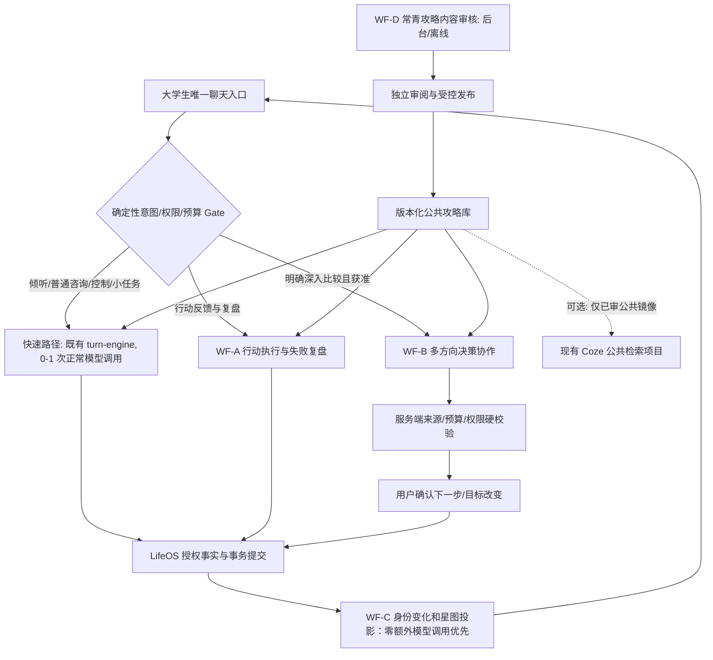

# LifeOS 新一代 Agent／Workflow／Skill 完整开发与验收计划

> 制定于 2026-10-10。目标：把扣子编排和 LifeOS 主产品的价值闭环做实，而非堆砌 Agent 数量。
> **本文件为开发工单与验收契约，并非代码已实现声明。**

## 0. 已核查基线（执行前仍须重新核对）

- 仓库：`D:\aaaLife\LifeOS`；分支 `fix/campus-acceptance-contract-20261006`；本次 HEAD `70914b1cbd55b75a4d0f74785163d33519f70f71`。
- **工作区约40项未提交修改／新增**，正在开发常青攻略库与 Coze 接线：`server/turn-engine.ts`、`store.ts`、`coach-knowledge.ts`、`server/guide-usage.ts`、`server/knowledge-index.ts`、迁移 029、前端 FullMethod 等。不得 reset、clean 或覆盖另一开发任务。
- `.planning/research/evergreen/KB_ACCEPTANCE.md`：112候选；32张结构化卡；16 approved（本地原文审阅，不代表独立人工最终审核），16 needs_review；53/112有内容覆盖、59 awaiting_source。尚无新版正常真实 Provider／4条3会话链／20普通合格样本的签收。整体 WIP_NOT_READY。
- 服务端类型检查尚有**38类既有错误**，须单独收口，不能用部分绿测冒充全库通过。唯一付费账本约2022条，**1条未结算终态**，余额仅为历史估算，新增付费前核对真实状态。
- Coze CLI 与 Codex 配套操作技能均为 `0.3.11`，`using-coze-cli`／`coze-code` 可用；不用重装。
- Coze 现有编排项目 `7693388932939300905`（多智能体成长工作流），11:53实际只读部署状态 Succeeded，commit `4aa53641b7177604cfa96631b9584de991531324`。
- Coze 现有检索项目 `7693465311558795327`（公共资料检索工作流），同次只读部署 Succeeded，commit `04849caa93a33f4584ce5637acba864e97757a46`。
- 本地业务 Skill `skills/lifeos-personal-companion/SKILL.md` 更新到 `1.2.1 local WIP`；后端指纹、用户级副本、扣子发布副本未因此自动更新。
- `COZE_CODEX_HANDOFF.md` 与 `.planning/research/coze-codex/COZE_MIRROR_PLAN.json` 已存在。**常青攻略云端镜像为 LOCAL_PLAN_NOT_SYNCED，不能说已经发布。**
- 原冻结 Final D Gate 针对更早运行代码，不能直接为新多智能体与新知识库验收背书。

先读：`PRODUCT.md`、`AGENTS.md`、`COZE_CODEX_HANDOFF.md`、`.planning/research/evergreen/HANDOFF.md`、`KB_ACCEPTANCE.md`、`KB_GAPS.md`、`skills/lifeos-personal-companion/SKILL.md`、`server/agent.ts`、`server/turn-engine.ts`、`server/store.ts`、`server/guide-usage.ts`、`server/user-themes.ts`、`server/identity.ts`、`server/knowledge-index.ts`、`server/coze-code-workflow.ts`、`server/coze-knowledge.ts`、`server/turn-contract.ts`。

## 1. 不可改变的产品核心

LifeOS 是**一个长期理解大学生的 AI 伙伴**，服务就业、考研、保研、考公、创业、自由职业、留学、课程、科研、社团、生活与身心恢复。普通用户只面对一个对话入口，不选择「考研 Agent」「创业 Agent」等机器人。

主要目标：`当前问题 → 获取真正相关的个人事实 → 必要的专业分析或方法 → 一个低成本可开始的动作 → 真实执行反馈 → 证据更新／方向调整 → 下次有变化的建议`。

- 不用人格、身份等级、星星数量、专业分数替代个人证据。
- 仅用户报告或真实工具回执可以形成执行事实；助手建议不等于用户接受或执行。
- 当前用户明确意图优先于旧主题，Memory OFF、遗忘、暂停使用、停止推荐和跨账号隔离适用于**所有**工作流。
- 默认快速聊天不新增长串行模型调用，不把私人资料上传 Coze 演示项目。
- 复杂专门任务是否采用多 Agent，靠盲测价值与成本对照决定；展示节点数量不构成产品价值。

## 2. 总体架构：统一主 Agent + 四条条件触发工作流



**不新增另一套用户画像 DB。** 原权威层仍是 `growth_items`／`coach_events`／`experiences`／`user_themes`／`identity_claims`／`identity_change_events`／`kb_guide_usage`。新工作流表只存执行元数据、候选方案和审计，不能和这些事实双写。内部专业 Agent 不直接执行个人状态写入。

### 2.1 哪些是模型 Agent，哪些是工具

| 执行角色 | 类型 | 职责与边界 |
|---|---|---|
| 主 Agent／响应整合 | 产品既有模型 | 用户唯一伙伴；普通聊天默认只发这一个正常模型调用 |
| Case Resolver | 确定性检索＋必要时模型解释 | 找同一事件/原行动，遇多候选要求澄清，不猜引用 |
| Evidence Guardian | 确定性校验，复杂冲突可有单独审查 Agent | 检查 quote、sourceId、revision、撤回、本人/他人、结果强度；无权生成已保存事实 |
| Action Reviewer | 按需推理 Agent | 根据实际尝试阶段找卡点，产出缺口或动作候选 |
| Path Analysts | 复杂任务下 2–3 个可并行实例 | 分析不同候选路径，按相同数据契约输出投入/收益边界/未知；不是16个固定机器人 |
| Conflict Reviewer | 独立推理 Agent + 硬校验 | 审查各路径冲突、时间预算、不确定结论与证据夸大 |
| Decision Synthesizer | 按需模型 Agent | 输出可解释阶段取舍与低成本实验，不替用户作人生最终选择 |
| Growth Diff | 确定性后提交处理 | 比较旧/新事实与关系，重算星图投影和变化时间线；默认0模型 |
| Source Researcher / Extractor / Skeptic | **资料维护**多 Agent | 找真正原文、提炼动作、查证／反例；不能自我批准发布 |
| Human Release Reviewer | 人工审批 + 程序校验 | 对公共卡独立签收，版本冻结、证据锁定、可撤回 |

## 3. 统一开发契约（先完成，不立即接入主引擎）

建立独立的 `server/workflows/` 模块，先以零网络／模拟工具实现：

- `contracts.ts`：`WorkflowMode`、`WorkflowRequest`、`EvidenceRef`、`AgentResult`、`WorkflowProposal`、`WorkflowReceipt` 等版本化 TypeScript schema。
- `router.ts`：优先保护拒绝建议、纯倾听、记忆控制；在后续事件、复杂取舍、普通方法之间判断，不用关键词单独触发高成本协作。
- `orchestrator.ts`：DAG／分支／并行／取消／deadline／幂等 requestId；记录真实状态，不假称 Agent 运行。
- `adapters.ts`：LifeOS 内部已授权读工具；只读 Coze 公共资料；各项 Agent 能力适配器。
- `evidence-gate.ts`：硬来源、快照、可见范围、撤回、事实/推断强度、budget 边界。
- `receipts.ts`：区分 `proposed / approved_by_user / persisted / rejected / unavailable`。
- `trace.ts`：仅脱敏记录 `workflowId/version/traceId/agentRole/inputRefDigest/outputRefDigest/usedEvidenceIds/latency/providerCalls/cost/status/error`，不记录原聊天明文或凭据。

示例接口（仅契约示意，按实际 schema 调整）：

```ts
type WorkflowRequest = {
  schemaVersion: 1;
  traceId: string;
  mode: 'action_review' | 'direction_decision' | 'growth_diff' | 'kb_maintenance';
  internalActorKey: string; // 服务端内部使用，绝不发到公共Coze
  conversationId?: string;
  eventId?: string;
  authorizedEvidenceRefs: {type:string; id:string; revision:number}[];
  currentIntent: string;
  budget?: {period:string; amountMinutes:number; sourceId:string} | null;
  modelBudget: {maxProviderCalls:number; maxCostCny:number; deadlineMs:number};
};
type WorkflowProposal = {
  traceId: string;
  evidenceRefs: {type:string; id:string; revision:number}[];
  hypotheses: {text:string; limitation:string; needsConfirmation:boolean}[];
  alternatives: {title:string; pro:string[]; tradeoffs:string[]; unknowns:string[]}[];
  nextActions: {description:string; estimatedMinutes:number|null; stopCondition:string}[];
  suggestedStateChanges: unknown[]; // 非实际DB写入
};
```

所有 Agent 接口都有 `timeout`、`unavailable`、`cancelled`、`stale_snapshot`。业务提交仍交给现有 LifeOS 事务边界，模型只给候选，不直接创建或删除用户事实。

## 4. 四条工作流详细开发

### WF-A：行动执行与失败复盘（**产品第一个交付**）

**触发：** 已知或可能存在先前行动，用户说“我试过了/没回复/没用上/卡住了/做完了”等，并且当前确实希望继续分析；纯倾听与明确拒绝建议先尊重。不能因为用户说了“失败”就自动定位到其他事件。

DAG：`event_retrieval → same_event_check → action/feedback classifier → evidence_guard → (必要时 method retrieval) → Action Reviewer → server validate → personal response → commit receipt`。

七种攻略使用状态继续沿用 `suggested/accepted/attempted/waiting_result/completed/declined/blocked`。输出必须区分“已发消息”“对方已读”“对方答复”“对方使用”“实际效果”；只报道没回复时，不判断成拒绝或能力差。

**验收例：** 学生接受了联系学长的方法 → 发出问题 → 三天未回 → LifeOS记住具体对象与请求、问关键缺口或建议低成本下一步 → 学生拒绝继续 → 不换说法重推。跨至少三个会话，重复读回必须一致；2个相似事件不得串线。

**成本：** 常规复盘不新增模型调用；事件检索与判断尽量走确定性工具。新增独立审查模型只为经证明有价值的难案启用。

### WF-B：多方向阶段决策（**比赛重点**）

**触发：** 用户正在权衡至少两个真实路径，且明确需要深入比较；或选择“深入分析”。普通“考研还是就业好”缺少本人情况时，优先给初步对比或问一个关键缺口，不立刻运行收费多 Agent。

DAG：

1. `case_envelope`：只读本人已授权经历、重视点、目标、时间/经济限制、禁止推荐边界，固定快照。
2. `path_analyst ×2–3`：不同候选路径并行，输入相同事实源，输出同一 JSON schema：依据、个人可能获益、投入、未知、可逆探索。
3. `hard_constraint_validator`：代码验证时间预算、近期硬节点、来源身份、禁止方向与知识适用边界。
4. `independent_critic`：审查各分析互相矛盾之处、过度推断和遗漏的反例；只提出问题，不直接修改个人记忆。
5. `decision_synthesizer`：整合“本阶段可考虑的路径—为何—证据—未知—最小探索”。所有建议是候选。
6. `user_confirm`：只有用户明确选择、确认或真实行动后，调用 LifeOS 原有受控写入；否则不更新当前正式目标。

例：大三、每周6小时，在就业、考研、独立开发之间权衡；要求展示“为何不建议同时高强度投入”“先核实哪件事能改变判断”；不能输出伪科学适配百分比。

**真实多 Agent 触发仅此类复杂任务：** 最多3并行分析 + 1独立评审 + 1合成（至多5次模型请求），实际按候选数和已授权预算封顶。用户能看到真实进度并取消；接口超时不能假装完成。

**部署策略：** 先在既有 Coze 多智能体成长项目使用合成成年学生演示；真实学生数据仅留在 LifeOS。生产需要多 Agent 时，优先在 LifeOS 私有服务实现相同接口、获准后启用；不默认把个人档案发送公共 Coze。

### WF-C：成长证据与身份变化（**差异化产品**）

**触发：** `finishRun` 等现有合法事务真正保存新经历、反馈、目标更正或身份自述之后；无变化不运行。默认零额外收费模型调用。

DAG：`commit receipt → old/new revision diff → provenance verifier → identity/goal/experience boundaries → star-map projection → delta UI`。

可见输出必须是：`此前如何理解 → 新增哪条具体证据 → 现在能说什么 → 仍未知什么 → 下一步变化是否需要本人确认`。用户不确认的观察不升级成“我就是某类人”。

**特别整改：** `server/experience-insight.ts` 当前可能把一次作品产出说成整体“有设计能力”，把模糊第三方评价说成“外部认可”；现有 identityLevel 的升级话术也可能造成等级式暗示。修复为任务范围内的证据事实、可撤销解释；不把更大/更亮的星球当人格更高级的标志。

**验收：** 第一次有偿设计→只能说该次交付与付款；用户报告时间压力→新增限制；明确就业优先→原经历不丢、方向状态发生变化；下一会话给的建议使用新事实，且能说明依据。

### WF-D：常青攻略生产／核验／去重（**后台多 Agent**）

**触发：** 内容维护任务，不随学生每一轮聊天运行。复用现有 `.planning/research/evergreen` 成果，绝不另建一份未关联的在线知识库。

DAG：`source_finder → primary_source_reader → step_extractor → independent_skeptic → coverage/duplicate gate → human_review → versioned_publish → offline_index → staged_mirror(optional)`。

- 来源研究：原文 URL、作者、作品ID、字幕时间/段落、实际读取范围。
- 内容提炼：问题、适用条件、步骤、微行动、反馈分支、限制；区分“原文支持”和 LifeOS 创作性适配。
- 反证审查：原文是否支持每一条主张？重复转载是否被当成两份独立来源？是否把单一个案夸大成普遍规律？
- 去重与覆盖：按问题/任务阶段/方法机制/适用边界规范 ID；112个候选各有 covered/merged/awaiting_source/excluded，不默默漏项。
- 独立审批：模型不得自我批准；版本、哈希、来源撤回链全部原子化。
- 公共镜像：先在 LifeOS 内批准内容；Coze 公共检索项目仅同步批准的公开镜像。写入/部署需明确授权；未确认 datasetId 时保持 LOCAL_PLAN_NOT_SYNCED。绝不上传学生私人对话、星图、身份或行动记录。

## 5. Skill 结构：1个主 Skill + 5个可复用专业 Skill

保留 `lifeos-personal-companion` 为**唯一对话体验**，它负责业务调度与用户边界；新增：

| Skill 名称 | 调用条件 | 不允许做的事 |
|---|---|---|
| `lifeos-direction-analysis` | 多方向取舍，非日常单问 | 不能替用户作最终选择；不能编成功率 |
| `lifeos-action-review` | 本人执行反馈与卡点复盘 | 不能重复初次教程；不能臆测失败原因 |
| `lifeos-experience-evidence` | 项目、作品、导师/客户反馈 | 不能由一次行为生成稳定人格或能力等级 |
| `lifeos-guide-application` | 需要方法，且有approved攻略 | 不能使用未审卡或引用假来源；不能把方法写成用户执行事实 |
| `lifeos-growth-diff` | 真实提交后的主题与身份变化 | 不能根据推测变更用户认同；不能泄漏已遗忘原话 |

每个 `SKILL.md` 必须写明：**触发条件、输入引用、步骤、输出JSON、工具权限、不得执行的操作、失败降级、至少6条正/负/多轮例子、版本**。

`using-coze-cli`／`coze-code` 属于 Codex 开发者技能，**不计入学生端业务 Skill**。已安装匹配0.3.11，不重复安装。技能调用必须有真实 trace 证明被启用，不能只有文件夹。

## 6. Coze 现有项目怎么改，而不是重建

1. **多智能体成长工作流**：保留项目 `7693388932939300905`。先只读拉取当前项目元数据、云端任务与实际部署版本；与旧 `schemaVersion`、`intent_router`、控制/事实/伙伴/攻略分支兼容。先在云开发候选版本上增加 WF-A 的状态机和 WF-B 的并行评审节点，输出可审计中间结果摘要与最终回执；严禁用真实学生数据作演示。
2. **公共资料检索**：保留 `7693465311558795327`；云侧仅返回候选公开来源，绝不能自己标记“verified”。本地权威版本 `guideId/revision/sourceHash` 对齐后才启用公共镜像。旧版8卡不能用来冒充现在16张已审卡同步成功。
3. **扣子发布业务 Skill**：仓库 `1.2.1 local WIP` 必须在后端指纹/真实读取契约/授权都可用后再同步。分别验证自动触发、纯对话降级、真实提交回执、跨会话承接；未验证独立新会话触发就标记 NOT_TESTED。
4. 云端节点追踪：角色、输入字段类别、路由分支、证据ID、状态、耗时和错误，不显示模型隐藏思考过程或真实个人敏感信息。
5. Coze CLI 使用当前有效 OAuth，只读 `project get`、`deploy status`、`skill list`、任务状态；所有写入、收费云编程消息、发布、Token变更要按本轮授权、预算及风险门槛执行，不自动重试、不创建重复项目。
6. 新接口优先 `schemaVersion:2`，保持老接口兼容或显式提供适配层；不能让现有部署调用在不知情时破坏契约。

## 7. 严格执行顺序（G0—G8）

### G0：冻结与冲突处理（零模型费用）
- 立即审计 `git status` 和当前已进行中的 Codex 工作；不要更改、覆盖、暂存或提交别人正在修改的40项内容。
- 等常青攻略任务建立正式可回滚检查点后，再与工作流共用文件做一次集成。此前**在独立 worktree／新模块**推进 schemas、trace、评估夹具与 Coze 合成演示。
- 建立 `AGENT_WORKFLOW_BASELINE.md`：HEAD、脏文件、知识审核状态、平台部署、Skill差异、38类基线错误、未结算调用、预算快照；判断可用端口的真实 `/api/run/version`，不能拿旧容器的接口当新版服务。
- G0 输出 `INTEGRATION_BLOCKED` 或 `READY_FOR_CONTRACT_ONLY`，不把冲突藏起来。

### G1：统一契约与主路由（零网络）
- 实施 `server/workflows/contracts/router/evidence-gate/trace`，默认 feature flag `LIFEOS_ADVANCED_WORKFLOWS=false`。
- 不改 `turn-engine` 的默认生成路径；先用模拟消息对照所有：普通问答、倾听、拒绝、纯记忆控制、新机会、复盘、复杂取舍。
- 校验跨账号、Memory OFF、遗忘、暂停/停止推荐、取消、并发修订、来源失效；异常一律无个人写入。
- 通过：复杂请求可正确候选触发；普通请求不新增 Provider 调用；trace 脱敏。

### G2：WF-A + action-review Skill（先做真正有用的）
- 使用现有 coach_events 与 kb_guide_usage；先模拟 Provider 和隔离PG，不复制用户个人数据库。
- 重点验收“联系→没回复→沟通原因未知→换一种下一步→用户拒绝”跨3会话，以及两个相似事件的身份隔离。
- 与旧单 Agent 进行逐轮对照，不能只是多生成几段流程描述。
- 通过：每一步行动状态有来源；无建议→已执行误写；同一已回答问题不重复追问；不强推拒绝方向。

### G3：WF-B + direction-analysis Skill（比赛主线）
- 在现有 Coze 多智能体项目做合成数据候选版：2–3并行路径分析 + 独立审阅 + 预算/来源硬校验 + 候选行动合成。
- 本地产品默认关闭深度协作，明示耗时与费用，用户选择后才启用；超时可取消或诚实退回普通方案。
- 真实学生数据不得默认发送 Coze。若需产品深度模式，优先在私有服务运行同契约，仍由 LifeOS 数据库负责权限与事务。
- 通过：真实节点执行trace、来源冲突检出、预算冲突检出、拒绝方向不参与比较、用户未确认不写当前目标。

### G4：WF-C + evidence/growth-diff Skills
- 只在真实提交变更后增量计算，默认零模型。
- 消除 `experience-insight.ts` 等过度断言、外部反馈强度夸大和强制身份升级话术。
- 浏览器显示“过去—新增证据—现在—仍未知—下一步”，可点击来源，更正后同步收回旧解释。
- 通过：无假身份、无历史撤回内容复活；新会话依据改变；桌面和390px可用。

### G5：WF-D + guide-application Skill
- 继续现有 evergreen 的16 approved／16 needs_review轨道，先补真实来源缺口，不能把未经审阅的16张强行上线。
- 采用维护多 Agent 分工 + 程序审计 + 独立审批。不要边生产内容边调整已冻结基准。
- 在确认公开镜像同步权限和目标后，才做Coze幂等同步、远端读回、哈希/版本一致性与撤回演练。
- 通过：素材有原文片段、主张可追溯、重复有去向、未审内容无资格用于用户回答。

### G6：集成与业务 Skill 发布候选
- 常青攻略冻结后，由单一集成者调整主 `turn-engine`／`store` 的最小连接点；三种工作流统一引用ID、提交快照与回执。
- 更新业务 Skill 版本并实测指纹、API、自动触发和降级。必要时在已有 Coze 项目内创建测试版本，不替换现有正式部署。
- 无账号授权、环境缺失、运行 Token无效：阻止对应远端业务调用，保留产品本地正确功能。

### G7：最终多层验收
- 第一层：纯函数、模拟 Provider、隔离 PG、事件与来源撤回、取消、幂等、并发、跨账号、Memory OFF。
- 第二层：至少16类路径的合成夹具 + 复合方向 + 4条跨至少3会话的连续链：行动复盘、就业vs自由职业、创业vs升学、课程/备考冲突。
- 第三层：真实模型小批与单 Agent 对照；同一冻结模型、输入、事实、知识、上下文，只替换协作路径。记录 `businessPass`、来源可信、预算冲突、反馈承接、学生实际步骤与模型调用总数。
- 第四层：真实 Coze 候选工作流演示和主Skill入口链（两者不能互相代替）；候选生成、引用审查、实际回执、独立学生会话、自愿降级。
- 第五层：正常快速聊天至少20个**预先冻结、全部保留**的真实普通交互，按 `PRODUCT.md` 检查首有效内容 p50≤3s、p95≤5s、完整 p95≤15s；不得拿云端工作流单独耗时代替整轮。复杂协作另报延迟/成本。
- 旧13失败零网络回放、相关全量测试、服务端类型错误收口、前端typecheck/build以及性能与源撤回回归全部需记录；旧基线已有失败不可被静默忽略。

### G8：候选版本、演示与生产放行
- 通过全部业务与权限门槛后生成 RELEASE_CANDIDATE，冻结代码／内容／Coze release／Skill 指纹／模型配置／测试集／费用账本。
- 产出3–5分钟比赛演示：同一个合成大学生，从方向不确定→专业分析→最小行动→执行受阻→复盘→星图变化→新会话建议改变。演示中可展开各Agent真实执行节点，但不展示私人用户信息。
- 任何生产部署/云端正式版本替换需要单独进行资源核验、备份、回滚与 smoke；本计划本身不授权直接发布生产。

## 8. 成本、速度与模型使用策略

- 普通聊天：保留当前 `qwen3.8-flash` 产品模型和既有动态协议，纯控制0次模型、普通主回答原则上≤1次，不增加额外审查 Agent。
- WF-A：优先原事件检索、确定性反馈和本轮正常模型；未经收益证明不加第二模型。
- WF-C：确定性 post-commit diff，默认0额外模型。
- WF-D：离线／后台维护，可多 Agent，但不得把维护成本转嫁成每位学生每轮实时成本。
- WF-B：学生显式选择或确有价值且获许可时启动多模型协作；**模型调用硬上限≤5**（2–3并行分析＋评审＋合成），每个任务须在实际预算允许范围内设置 `maxCostCny` 与 `deadlineMs`，超过即弃用深度模式或请求确认。
- 不预先声称复杂模式必然更快或更准确。至少20个冻结复杂案例做盲配对，包含反例与负样本；若改善不明显、成本或时延超阈值，保留快速方案并标记深度模式实验性。
- 唯一Provider账本有未结清调用。核实终态与余额之前，不发新付费验证请求，不重置或“补0”账本。

## 9. 最终验收矩阵（不得以展示效果取代）

| 维度 | 必过证明 |
|---|---|
| 唯一伙伴体验 | 学生只看到一位 AI，不必选择子 Agent |
| 条件编排 | 倾听/控制不启动复杂链；深度路径确实有并行/审查/合成的真实trace |
| 证据真实 | 无个人经历编造、无未审攻略引用、无外部评价强度夸大 |
| 状态严格 | suggest≠accept≠attempt≠complete；拒绝与未知正确保留 |
| 反馈闭环 | 同一行动跨3会话承接；下一次不从头重复攻略 |
| 方向变化 | 用户主动更改方向，旧目标不再自动推荐，旧真实经历仍可参考 |
| 个人权限 | Memory OFF、遗忘、暂停、拒绝、跨账号100%零违规 |
| 星图解释 | 每个有意义变化都有来源、边界与真实提交证据 |
| Skill 触发 | 有明确触发场景和运行trace，不仅是几个Markdown文件 |
| Coze云演示 | 项目/版本/真实workflow运行与错误路径可读；不冒充生产数据 |
| 公共检索 | 未审、退役、过期版本不得成为依据；远端镜像ID/hashes一致 |
| 速度与成本 | 默认路径满足原PRODUCT Gate；复杂路径独立测量并有硬预算上限 |
| 工程回归 | 源码、隔离PG、模拟与真实模型、浏览器、旧D-gate回放按冻结版本分层留证 |

**如果复杂多 Agent 在相同案例上不能比单 Agent提供更准确的取舍、减少错误归因或更好地承接反馈，不能因 Agent 较多而宣布“升级成功”。**

## 10. 交付文件与组织方式

交付至少：

- `AGENT_WORKFLOW_BASELINE.md`：最新真实环境与冲突状态。
- `AGENT_WORKFLOW_ARCHITECTURE.md`：Agent分工、四条DAG、数据留存边界。
- `AGENT_WORKFLOW_CONTRACTS.md`／实际可执行schema：输入输出、引用、错误、状态及版本。
- `AGENT_WORKFLOW_ROUTING.md`：触发与拒绝的正负例。
- `WORKFLOW_EXECUTION_TRACES.jsonl`：真实/模拟分开，脱敏 trace。
- `SKILL_REGISTRY.md` + 5个业务Skill及测试实例。
- `COZE_MULTIAGENT_CANDIDATE.md`：复用现有两个项目的变化、版本、节点、运行证据，明确未发布项。
- `MULTIAGENT_AB_EVAL.json` + `MULTIAGENT_COST_SPEED.md`：单/多Agent对照。
- `STARMAP_WORKFLOW_DIFF.md`：有来源的成长差异。
- `AGENT_WORKFLOW_FINAL_GATE.md`：冻结版本、逐项PASS/FAIL/NOT_TESTED和旧缺陷。
- `COMPETITION_DEMO_SCRIPT.md`：学生真实价值在前、执行图证据在后。

交付每阶段：commit/worktree指纹、改动文件、正确测试命令、总测试分母、真实失败、预算/延迟、下一步。正式云发布或生产替换在独立授权后执行。

## 11. 发给 Codex 的立即执行口令

> **开始 G0→G1→G2，不要一上来新建项目或增加模型调用。** 先确认当前另一个 Codex 的 evergreen 任务进度，保留脏工作区；使用独立 worktree／独立 `server/workflows/` 文件先落下可测契约和行动复盘链。复用现有 `7693388932939300905` 和 `7693465311558795327`，用现已安装的 Coze CLI 操作技能读取真实云版本；不得将云端编排与真实 LifeOS 私人 DB 混为一谈。只有 G2 的跨3会话反馈闭环通过后再实施 G3 的多方向协作及 G4 的成长变化解释。G5常青攻略审核继续沿用原任务，不另造库。每个 Gate 交付状态、证据与回归，不在失效时自动付费重试或擅自上线。
